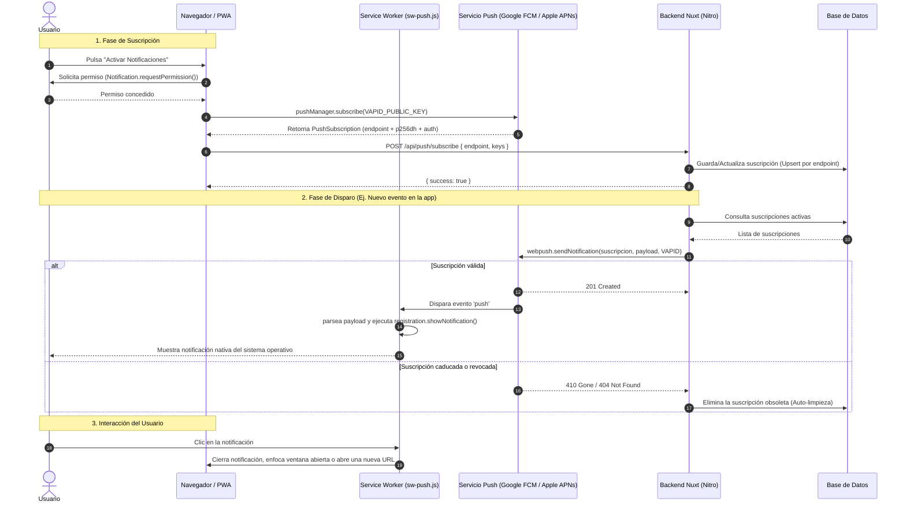

# Guía Definitiva: Implementación de Web Push Notifications en Nuxt PWA

Esta guía detalla paso a paso cómo implementar **Push Notifications nativas** en cualquier aplicación PWA construida con **Nuxt 3 o Nuxt 4**, utilizando el estándar de la W3C (Web Push API) junto con **VAPID**, **`@vite-pwa/nuxt`** y la librería backend **`web-push`**.

---

## 1. Arquitectura y Flujo de Comunicación

El estándar Web Push funciona como un triángulo entre el **Navegador del Usuario**, el **Servicio Push del Proveedor del Navegador** (Google FCM para Chrome/Android, Apple APNs para Safari/iOS, Mozilla Autopush para Firefox) y tu **Servidor Nuxt (Nitro)**.



---

## 2. Instalación de Dependencias

En la raíz de tu proyecto Nuxt, instala el módulo PWA y el paquete oficial de Web Push:

```bash
# Con pnpm
pnpm add @vite-pwa/nuxt web-push
pnpm add -D @types/web-push

# O con npm
npm install @vite-pwa/nuxt web-push
npm install -D @types/web-push
```

---

## 3. Generación de Llaves VAPID

VAPID (*Voluntary Application Server Identification*) permite que tu servidor Nuxt se autentique de forma segura ante Google, Apple y Mozilla sin necesidad de crear cuentas de desarrollador en cada plataforma.

Ejecuta en tu terminal:

```bash
npx web-push generate-vapid-keys
```

Obtendrás una salida similar a esta:

```text
=======================================
Public Key:
BBHQJKqHae_Ysp-iCAx7neo2UpfKtEIWZ9LY9cvdCeyCwMYJbpjJG47htGHmCxF2555Xm9ctTew_kIv08PBYrZg

Private Key:
JBT9l9rPr55jiqHFjB-muh0zQMOVxEo-h33pwIGYPjA
=======================================
```

> [!WARNING]
> Guarda la **Private Key** en estricto secreto. Si cambias estas llaves en el futuro, las suscripciones existentes quedarán invalidadas y los usuarios tendrán que volver a activar las notificaciones.

### Configurar `.env`

Añade las credenciales a tu archivo `.env`:

```env
# Llave pública compartida con el frontend
VAPID_PUBLIC_KEY=tu_public_key_aqui

# Llave privada que reside SOLO en el backend
VAPID_PRIVATE_KEY=tu_private_key_aqui

# Contacto requerido por los proveedores push (correo con prefijo mailto: o URL https)
VAPID_SUBJECT=mailto:admin@tu-dominio.com
```

---

## 4. Configurar `nuxt.config.ts`

En tu archivo de configuración de Nuxt, registra el módulo PWA, expón las llaves en `runtimeConfig`, y configura Workbox para que importe el script que gestiona las notificaciones push:

```typescript
// nuxt.config.ts
export default defineNuxtConfig({
  modules: [
    '@vite-pwa/nuxt'
  ],

  pwa: {
    manifest: {
      name: 'Mi Aplicación PWA',
      short_name: 'MiPWA',
      description: 'Mi PWA con notificaciones Web Push',
      theme_color: '#0f172a',
      background_color: '#020617',
      display: 'standalone',
      orientation: 'portrait',
      start_url: '/',
      icons: [
        {
          src: '/pwa-192x192.png',
          sizes: '192x192',
          type: 'image/png'
        },
        {
          src: '/pwa-512x512.png',
          sizes: '512x512',
          type: 'image/png'
        }
      ]
    },
    workbox: {
      // Importa el script del service worker que escuchará los eventos 'push'
      importScripts: ['sw-push.js'],
      navigateFallback: null,
      navigateFallbackDenylist: [/^\/api/]
    },
    client: {
      installPrompt: true
    },
    devOptions: {
      // Actívalo si necesitas depurar el Service Worker en entorno de desarrollo local
      enabled: false
    }
  },

  runtimeConfig: {
    // Variables privadas del servidor
    vapidPrivateKey: process.env.VAPID_PRIVATE_KEY || '',
    vapidSubject: process.env.VAPID_SUBJECT || '',
    public: {
      // Variable pública expuesta al navegador
      vapidPublicKey: process.env.VAPID_PUBLIC_KEY || ''
    }
  }
})
```

---

## 5. El Service Worker: `public/sw-push.js`

Crea el archivo `public/sw-push.js`. Este script corre en segundo plano en el navegador del usuario y se encarga de:
1. **Recibir el payload del push** y mostrar la notificación nativa mediante `self.registration.showNotification`.
2. **Gestionar el clic**: si la aplicación ya está abierta en una pestaña o ventana independiente, la enfoca y navega a la URL indicada; si está cerrada, abre una nueva ventana.

```javascript
// public/sw-push.js
// Manejadores Web Push cargados por Workbox vía importScripts

self.addEventListener('push', (event) => {
  let data = {}
  if (event.data) {
    try {
      data = event.data.json()
    } catch {
      data = { body: event.data.text() }
    }
  }

  const opciones = {
    body: data.body || '',
    icon: data.icon || '/pwa-192x192.png',
    badge: data.badge || '/pwa-192x192.png',
    tag: data.tag, // Si se envía un tag, notificaciones con el mismo tag se reemplazan
    data: {
      url: data.url || '/'
    }
  }

  event.waitUntil(
    self.registration.showNotification(data.title || 'Nueva Notificación', opciones)
  )
})

self.addEventListener('notificationclick', (event) => {
  event.notification.close()
  const destino = new URL(event.notification.data?.url || '/', self.location.origin).href

  event.waitUntil((async () => {
    const ventanas = await self.clients.matchAll({ type: 'window', includeUncontrolled: true })

    // Reutilizar la pestaña o ventana de la app si ya está abierta
    for (const ventana of ventanas) {
      if (new URL(ventana.url).origin === self.location.origin) {
        await ventana.focus()
        await ventana.navigate(destino).catch(() => {})
        return
      }
    }

    // Si la app está cerrada, abrir una ventana nueva
    await self.clients.openWindow(destino)
  })())
})
```

---

## 6. Modelo de Base de Datos para Suscripciones

Cada dispositivo o navegador registrado genera una suscripción única. Necesitas almacenar:
- `endpoint`: La URL del servidor push del navegador (única).
- `p256dh`: La llave pública ECDH del cliente.
- `auth`: El secreto de autenticación compartido.
- Opcionalmente: `user_agent`, `user_id` y fecha de creación.

### Ejemplo con Drizzle ORM (SQLite / PostgreSQL / MySQL):

```typescript
// server/db/schema.ts
import { sqliteTable, text, integer } from 'drizzle-orm/sqlite-core'

export const pushSubscriptions = sqliteTable('push_subscriptions', {
  id: integer('id').primaryKey({ autoIncrement: true }),
  endpoint: text('endpoint').notNull().unique(),
  p256dh: text('p256dh').notNull(),
  auth: text('auth').notNull(),
  user_agent: text('user_agent'),
  created_at: text('created_at').notNull()
})
```

---

## 7. Utilidades Compartidas (`shared/utils/pushNotificaciones.ts`)

Crea un archivo utilitario en `shared/utils/` para que pueda importarse tanto en el frontend como en el backend (`#shared/utils/pushNotificaciones`):

```typescript
// shared/utils/pushNotificaciones.ts

export interface PushPayload {
  title: string
  body: string
  url?: string
  tag?: string
  icon?: string
}

export interface DatosNotificacionGasto {
  id?: number
  monto: number
  moneda?: string
  comercio: string
  tarjetaNombre?: string | null
}

export function formatearMonto(monto: number, moneda = 'USD'): string {
  try {
    return new Intl.NumberFormat('en-US', {
      style: 'currency',
      currency: moneda,
      minimumFractionDigits: 2,
      maximumFractionDigits: 2
    }).format(monto)
  } catch {
    return `${moneda} ${monto.toFixed(2)}`
  }
}

export function construirNotificacionGasto(datos: DatosNotificacionGasto): PushPayload {
  const monto = formatearMonto(datos.monto, datos.moneda)
  const detalle = datos.tarjetaNombre ? ` · ${datos.tarjetaNombre}` : ''

  return {
    title: 'Nuevo gasto registrado',
    body: `${monto} en ${datos.comercio}${detalle}`,
    url: '/gastos',
    tag: datos.id ? `gasto-${datos.id}` : undefined
  }
}

export function construirNotificacionError(motivo: string, detalle?: string): PushPayload {
  const texto = detalle ? `${motivo}: ${detalle}` : motivo

  return {
    title: '⚠️ Error en el registro de gastos',
    body: texto.length > 150 ? `${texto.slice(0, 147)}...` : texto,
    url: '/gastos'
  }
}

// Convierte la llave pública VAPID (base64url) al Uint8Array binario que espera pushManager.subscribe()
export function base64UrlAUint8Array(base64Url: string): Uint8Array<ArrayBuffer> {
  const padding = '='.repeat((4 - (base64Url.length % 4)) % 4)
  const base64 = (base64Url + padding).replace(/-/g, '+').replace(/_/g, '/')
  const raw = atob(base64)
  const output = new Uint8Array(raw.length)
  for (let i = 0; i < raw.length; i++) {
    output[i] = raw.charCodeAt(i)
  }
  return output
}

// Los servicios push de Google/Apple devuelven 404 o 410 cuando una suscripción expiró o el usuario revocó el permiso
export function suscripcionExpirada(statusCode?: number): boolean {
  return statusCode === 404 || statusCode === 410
}
```

---

## 8. Endpoints Nitro y Envío en el Backend

### 8.1. Utilidad de Envío y Limpieza Automática (`server/utils/webPush.ts`)

```typescript
// server/utils/webPush.ts
import webpush from 'web-push'
import { eq } from 'drizzle-orm'
import { db } from '../db'
import { pushSubscriptions } from '../db/schema'
import { suscripcionExpirada, type PushPayload } from '#shared/utils/pushNotificaciones'

export interface ResultadoEnvioPush {
  total: number
  enviadas: number
  fallidas: number
  eliminadas: number
}

function obtenerVapid() {
  const config = useRuntimeConfig()
  const publicKey = config.public.vapidPublicKey
  const privateKey = config.vapidPrivateKey
  const subject = config.vapidSubject

  if (!publicKey || !privateKey || !subject) return null
  return { publicKey, privateKey, subject }
}

export function pushConfigurado(): boolean {
  return obtenerVapid() !== null
}

export async function enviarPush(
  payload: PushPayload,
  opciones: { endpoint?: string } = {}
): Promise<ResultadoEnvioPush> {
  const resultado: ResultadoEnvioPush = { total: 0, enviadas: 0, fallidas: 0, eliminadas: 0 }
  const vapidDetails = obtenerVapid()

  if (!vapidDetails) {
    console.warn('[web-push] Faltan llaves VAPID configuradas en el servidor')
    return resultado
  }

  const suscripciones = opciones.endpoint
    ? await db.select().from(pushSubscriptions).where(eq(pushSubscriptions.endpoint, opciones.endpoint))
    : await db.select().from(pushSubscriptions)

  resultado.total = suscripciones.length
  const cuerpo = JSON.stringify(payload)

  await Promise.all(suscripciones.map(async (s) => {
    try {
      await webpush.sendNotification(
        { endpoint: s.endpoint, keys: { p256dh: s.p256dh, auth: s.auth } },
        cuerpo,
        {
          vapidDetails,
          TTL: 60 * 60 * 24, // 24 horas de vigencia en el servidor push
          urgency: 'high',
          timeout: 5000 // 5 segundos máx para no bloquear funciones serverless
        }
      )
      resultado.enviadas++
    } catch (err: any) {
      const statusCode = err?.statusCode
      if (suscripcionExpirada(statusCode)) {
        // El dispositivo revocó permisos o desinstaló la PWA: eliminar suscripción obsoleta
        await db.delete(pushSubscriptions).where(eq(pushSubscriptions.id, s.id))
        resultado.eliminadas++
      } else {
        resultado.fallidas++
        console.error('[web-push] Error enviando notificación', { statusCode, endpoint: s.endpoint, err })
      }
    }
  }))

  return resultado
}
```

### 8.2. Endpoint para Suscribirse (`server/api/push/subscribe.post.ts`)

```typescript
// server/api/push/subscribe.post.ts
import { db } from '../../db'
import { pushSubscriptions } from '../../db/schema'

export default defineEventHandler(async (event) => {
  const body = await readBody(event)
  const endpoint = body?.endpoint
  const p256dh = body?.keys?.p256dh
  const auth = body?.keys?.auth

  if (!endpoint || !p256dh || !auth) {
    throw createError({ statusCode: 400, message: 'Faltan parámetros de suscripción (endpoint, p256dh, auth)' })
  }

  if (!URL.canParse(endpoint) || new URL(endpoint).protocol !== 'https:') {
    throw createError({ statusCode: 400, message: 'El endpoint debe ser una URL https válida' })
  }

  const userAgent = getHeader(event, 'user-agent') || null

  // Upsert: si el endpoint ya existe, actualiza sus llaves criptográficas
  await db.insert(pushSubscriptions).values({
    endpoint,
    p256dh,
    auth,
    user_agent: userAgent,
    created_at: new Date().toISOString()
  }).onConflictDoUpdate({
    target: pushSubscriptions.endpoint,
    set: { p256dh, auth, user_agent: userAgent }
  })

  return { success: true }
})
```

### 8.3. Endpoint para Desuscribirse (`server/api/push/unsubscribe.post.ts`)

```typescript
// server/api/push/unsubscribe.post.ts
import { eq } from 'drizzle-orm'
import { db } from '../../db'
import { pushSubscriptions } from '../../db/schema'

export default defineEventHandler(async (event) => {
  const body = await readBody<{ endpoint?: string }>(event)
  if (!body?.endpoint) {
    throw createError({ statusCode: 400, message: 'Falta el endpoint' })
  }

  await db.delete(pushSubscriptions).where(eq(pushSubscriptions.endpoint, body.endpoint))
  return { success: true }
})
```

### 8.4. Endpoint de Notificación de Prueba (`server/api/push/test.post.ts`)

```typescript
// server/api/push/test.post.ts
import { enviarPush, pushConfigurado } from '../../utils/webPush'

export default defineEventHandler(async (event) => {
  const body = await readBody<{ endpoint?: string }>(event)
  if (!body?.endpoint) {
    throw createError({ statusCode: 400, message: 'Falta el endpoint de la suscripción' })
  }

  if (!pushConfigurado()) {
    throw createError({
      statusCode: 503,
      message: 'Web Push no está configurado en el servidor (VAPID_PUBLIC_KEY, VAPID_PRIVATE_KEY, VAPID_SUBJECT)'
    })
  }

  const resultado = await enviarPush({
    title: 'Notificaciones activas',
    body: 'Así te avisaremos cuando se registre un gasto desde tu correo.',
    url: '/configuracion',
    tag: 'push-prueba'
  }, { endpoint: body.endpoint })

  if (resultado.total === 0 || resultado.eliminadas > 0) {
    throw createError({
      statusCode: 404,
      message: 'Este dispositivo no tiene una suscripción vigente. Desactiva y vuelve a activar las notificaciones.'
    })
  }

  if (resultado.enviadas === 0) {
    throw createError({
      statusCode: 502,
      message: 'El servicio push del navegador rechazó la notificación. Revisa los logs del servidor.'
    })
  }

  return { success: true, ...resultado }
})
```

### 8.5. Disparo desde un Evento de Negocio o Webhook (`server/api/webhooks/hostinger.post.ts`)

En este proyecto, cuando llega un correo bancario al webhook de Hostinger, el servidor registra el gasto en la base de datos y notifica a todos los dispositivos suscritos sin bloquear ni hacer fallar la respuesta `200 OK` del webhook:

```typescript
// Fragmento de server/api/webhooks/hostinger.post.ts
try {
  await enviarPush(
    construirNotificacionGasto({
      id: nuevoGasto[0]?.id,
      monto: compra.monto,
      moneda: compra.moneda,
      comercio: compra.comercio,
      tarjetaNombre: tarjeta.nombre
    })
  )
} catch (e) {
  console.error('[hostinger-webhook] error enviando notificación push', e)
}
```

---

## 9. Composable de Vue 3: `app/composables/usePushNotifications.ts`

Este composable encapsula toda la interacción con la API nativa del navegador, la validación de rotación de llaves VAPID y la sincronización con tu backend:

```typescript
// app/composables/usePushNotifications.ts
import { base64UrlAUint8Array } from '#shared/utils/pushNotificaciones'

const SW_READY_TIMEOUT_MS = 10000
const SUBSCRIBE_TIMEOUT_MS = 30000

function conLimiteDeTiempo<T>(promesa: Promise<T>, ms: number, mensaje: string): Promise<T> {
  let timer: ReturnType<typeof setTimeout> | undefined
  const limite = new Promise<never>((_, reject) => {
    timer = setTimeout(() => reject(new Error(mensaje)), ms)
  })
  return Promise.race([promesa, limite]).finally(() => clearTimeout(timer))
}

function mismaLlave(actual: ArrayBuffer | null, esperada: Uint8Array): boolean {
  if (!actual || actual.byteLength !== esperada.byteLength) return false
  const bytes = new Uint8Array(actual)
  return bytes.every((b, i) => b === esperada[i])
}

export const usePushNotifications = () => {
  const vapidPublicKey = useRuntimeConfig().public.vapidPublicKey

  const soportado = ref(false)
  const configurado = computed(() => Boolean(vapidPublicKey))
  const permiso = ref<NotificationPermission>('default')
  const suscrito = ref(false)
  const endpointActual = ref<string | null>(null)
  const cargando = ref(false)

  const obtenerRegistro = async (): Promise<ServiceWorkerRegistration> => {
    const actual = await navigator.serviceWorker.getRegistration()
    if (actual?.active) return actual

    return conLimiteDeTiempo(
      navigator.serviceWorker.ready,
      SW_READY_TIMEOUT_MS,
      'El service worker no está activo. Si estás en desarrollo, compila con pnpm build o activa devOptions en nuxt.config.'
    )
  }

  const actualizarEstado = async () => {
    soportado.value = 'serviceWorker' in navigator && 'PushManager' in window && 'Notification' in window
    if (!soportado.value) return

    permiso.value = Notification.permission
    const registro = await navigator.serviceWorker.getRegistration()
    const suscripcion = await registro?.pushManager.getSubscription()

    suscrito.value = Boolean(suscripcion) && permiso.value === 'granted'
    endpointActual.value = suscripcion?.endpoint ?? null
  }

  const activar = async () => {
    if (!configurado.value) {
      throw new Error('El servidor no tiene configurada la llave pública VAPID.')
    }

    cargando.value = true
    try {
      permiso.value = await Notification.requestPermission()
      if (permiso.value !== 'granted') {
        throw new Error('No se otorgó permiso para mostrar notificaciones.')
      }

      const registro = await obtenerRegistro()
      const llave = base64UrlAUint8Array(vapidPublicKey)
      let suscripcion = await registro.pushManager.getSubscription()

      // Si las llaves VAPID cambiaron en el servidor, renovar suscripción
      if (suscripcion && !mismaLlave(suscripcion.options.applicationServerKey, llave)) {
        await suscripcion.unsubscribe()
        suscripcion = null
      }

      suscripcion ??= await conLimiteDeTiempo(
        registro.pushManager.subscribe({
          userVisibleOnly: true,
          applicationServerKey: llave
        }),
        SUBSCRIBE_TIMEOUT_MS,
        'El navegador no respondió al registrarse en el servicio push.'
      )

      await $fetch('/api/push/subscribe', {
        method: 'POST',
        body: suscripcion.toJSON()
      })

      suscrito.value = true
      endpointActual.value = suscripcion.endpoint
    } finally {
      cargando.value = false
    }
  }

  const desactivar = async () => {
    cargando.value = true
    try {
      const registro = await navigator.serviceWorker.getRegistration()
      const suscripcion = await registro?.pushManager.getSubscription()

      if (suscripcion) {
        const endpoint = suscripcion.endpoint
        await suscripcion.unsubscribe()
        await $fetch('/api/push/unsubscribe', {
          method: 'POST',
          body: { endpoint }
        }).catch(() => {})
      }

      suscrito.value = false
      endpointActual.value = null
    } finally {
      cargando.value = false
    }
  }

  const enviarPrueba = async () => {
    if (!endpointActual.value) {
      throw new Error('Este dispositivo no tiene notificaciones activas.')
    }
    await $fetch('/api/push/test', {
      method: 'POST',
      body: { endpoint: endpointActual.value }
    })
  }

  return {
    soportado,
    configurado,
    permiso,
    suscrito,
    cargando,
    actualizarEstado,
    activar,
    desactivar,
    enviarPrueba
  }
}
```

---

## 10. Interfaz de Usuario de Ejemplo (Vue 3 / Nuxt UI)

```vue
<script setup lang="ts">
const {
  soportado,
  configurado,
  permiso,
  suscrito,
  cargando,
  actualizarEstado,
  activar,
  desactivar,
  enviarPrueba
} = usePushNotifications()

const probando = ref(false)

onMounted(async () => {
  await actualizarEstado()
})

const onActivar = async () => {
  try {
    await activar()
    alert('¡Notificaciones activadas con éxito!')
  } catch (err: any) {
    alert(err?.message || 'Error al activar')
  }
}

const onDesactivar = async () => {
  try {
    await desactivar()
  } catch (err: any) {
    alert(err?.message || 'Error al desactivar')
  }
}

const onProbar = async () => {
  probando.value = true
  try {
    await enviarPrueba()
    alert('Notificación de prueba enviada')
  } catch (err: any) {
    alert(err?.message || 'Error al enviar prueba')
  } finally {
    probando.value = false
  }
}
</script>

<template>
  <div class="p-6 max-w-md mx-auto bg-slate-900 text-white rounded-2xl shadow-lg space-y-4">
    <h2 class="text-xl font-bold flex items-center gap-2">
      🔔 Notificaciones Push
    </h2>

    <!-- Estado: No soportado -->
    <div v-if="!soportado" class="p-3 bg-red-950/50 border border-red-500/30 rounded-xl text-xs text-red-200">
      Tu navegador no soporta notificaciones Web Push. En iOS (iPhone/iPad), añade la app a la pantalla de inicio primero.
    </div>

    <!-- Estado: Falta VAPID -->
    <div v-else-if="!configurado" class="p-3 bg-amber-950/50 border border-amber-500/30 rounded-xl text-xs text-amber-200">
      Faltan las variables VAPID en el servidor.
    </div>

    <!-- Estado: Permiso Bloqueado -->
    <div v-else-if="permiso === 'denied'" class="p-3 bg-red-950/50 border border-red-500/30 rounded-xl text-xs text-red-200">
      Las notificaciones están bloqueadas en los ajustes de tu navegador o sistema operativo.
    </div>

    <!-- Acciones -->
    <div v-else class="flex items-center justify-between pt-2">
      <span class="text-sm font-medium" :class="suscrito ? 'text-emerald-400' : 'text-slate-400'">
        {{ suscrito ? '● Activas en este equipo' : '○ Inactivas' }}
      </span>

      <div class="flex gap-2">
        <template v-if="suscrito">
          <button
            class="px-3 py-1.5 bg-slate-800 hover:bg-slate-700 text-xs rounded-lg font-medium transition"
            :disabled="probando"
            @click="onProbar"
          >
            {{ probando ? 'Enviando...' : 'Probar' }}
          </button>
          <button
            class="px-3 py-1.5 bg-red-600 hover:bg-red-700 text-xs rounded-lg font-medium transition"
            :disabled="cargando"
            @click="onDesactivar"
          >
            Desactivar
          </button>
        </template>
        <button
          v-else
          class="px-4 py-2 bg-emerald-600 hover:bg-emerald-500 text-xs font-semibold rounded-lg shadow-md transition"
          :disabled="cargando"
          @click="onActivar"
        >
          {{ cargando ? 'Activando...' : 'Activar notificaciones' }}
        </button>
      </div>
    </div>
  </div>
</template>
```

---

## 11. Reglas de Oro y Casos Especiales para Producción

1. **Requisitos en iOS / iPadOS (Safari en iPhone)**:
   - A partir de **iOS 16.4**, Apple admite Web Push, pero con una **condición obligatoria**: el usuario debe agregar la PWA a la pantalla de inicio (*Compartir → Añadir a pantalla de inicio*) y abrirla desde el icono de la pantalla de inicio en modo *standalone*. En Safari como pestaña normal, la API de Notificaciones está deshabilitada por diseño de Apple.
2. **HTTPS Obligatorio**:
   - Salvo en `localhost`, los navegadores modernos rechazan tajantemente registrar Service Workers o solicitar permisos de notificación en orígenes no seguros (`http://`). Tu app debe contar con certificado SSL/TLS en producción.
3. **Persistencia y Timeouts en Serverless (Vercel, Netlify, Cloudflare Workers)**:
   - Los servicios push externos (FCM, Apple APNs) pueden experimentar latencias de red. Si respondes a la solicitud HTTP antes de que termine `webpush.sendNotification()`, el runtime serverless congelará el proceso y la notificación nunca saldrá. Siempre usa `await` o `waitUntil` con un timeout seguro (ej. 5000 ms).
4. **Auto-limpieza de Suscripciones**:
   - Cada vez que envíes una notificación, captura los códigos `404` y `410` (*Gone*). Indican que el usuario desinstaló la PWA o revocó el permiso desde el sistema. Elimina esa fila de la base de datos para no gastar recursos en envíos infructuosos.
5. **Pruebas Locales**:
   - Para probar en local, recuerda compilar la app con `pnpm build && pnpm preview` para que Vite genere el Service Worker de Workbox, o activa `devOptions: { enabled: true }` en `nuxt.config.ts`.

---

## 12. Auditoría y Mejoras Recomendadas para este Proyecto (Paso a Paso)

Tras revisar la implementación actual del repositorio ([`public/sw-push.js`](../public/sw-push.js), [`server/utils/webPush.ts`](../server/utils/webPush.ts), [`server/api/push/subscribe.post.ts`](../server/api/push/subscribe.post.ts), [`app/composables/usePushNotifications.ts`](../app/composables/usePushNotifications.ts) y [`server/api/webhooks/hostinger.post.ts`](../server/api/webhooks/hostinger.post.ts)), estas son las **6 mejoras técnicas** recomendadas junto con los pasos exactos para implementarlas:

---

### Mejora 1: Protección Anti-SSRF Validando Dominios de Proveedores Push en `subscribe.post.ts`

- **Diagnóstico actual**: En [`server/api/push/subscribe.post.ts`](../server/api/push/subscribe.post.ts#L25), solo se verifica que el `endpoint` comience con `https:`. Como `webpush.sendNotification()` realiza peticiones `POST` desde el servidor hacia el `endpoint` almacenado, aceptar cualquier URL arbitraria expone al backend a **Server-Side Request Forgery (SSRF)** si alguien registra una URL hacia un servicio interno o de terceros.
- **Pasos para implementarlo**:
  1. En [`shared/utils/pushNotificaciones.ts`](../shared/utils/pushNotificaciones.ts), agrega una función validadora con la lista blanca (*allowlist*) de los proveedores oficiales W3C (Google FCM, Apple APNs, Mozilla Autopush y Microsoft WNS):
     ```typescript
     // shared/utils/pushNotificaciones.ts
     const DOMINIOS_PUSH_PERMITIDOS = [
       'fcm.googleapis.com',
       'android.googleapis.com',
       'updates.push.services.mozilla.com',
       'push.services.mozilla.com',
       'web.push.apple.com',
       'notify.windows.com'
     ]

     export function esEndpointPushValido(endpoint: string): boolean {
       if (!URL.canParse(endpoint)) return false
       const url = new URL(endpoint)
       if (url.protocol !== 'https:') return false
       return DOMINIOS_PUSH_PERMITIDOS.some(
         dominio => url.hostname === dominio || url.hostname.endsWith(`.${dominio}`)
       )
     }
     ```
  2. En [`server/api/push/subscribe.post.ts`](../server/api/push/subscribe.post.ts), reemplaza la validación actual por `esEndpointPushValido(endpoint)`:
     ```typescript
     import { esEndpointPushValido } from '#shared/utils/pushNotificaciones'

     if (!esEndpointPushValido(endpoint)) {
       throw createError({
         statusCode: 400,
         message: 'El endpoint no pertenece a un proveedor de notificaciones Web Push reconocido'
       })
     }
     ```

---

### Mejora 2: Renovación Automática en Segundo Plano (`pushsubscriptionchange`) en `public/sw-push.js`

- **Diagnóstico actual**: [`public/sw-push.js`](../public/sw-push.js) solo escucha `push` y `notificationclick`. Los proveedores (especialmente Apple en iOS y Firefox) pueden expirar o rotar las llaves de una suscripción en segundo plano y disparar el evento `pushsubscriptionchange`. Al no estar manejado, el servidor recibe un `410 Gone` en el siguiente gasto, borra la suscripción y el usuario deja de recibir alertas sin enterarse.
- **Pasos para implementarlo**:
  1. Abre [`public/sw-push.js`](../public/sw-push.js) y añade al final el listener para `pushsubscriptionchange`:
     ```javascript
     // public/sw-push.js
     self.addEventListener('pushsubscriptionchange', (event) => {
       event.waitUntil((async () => {
         try {
           const opciones = event.oldSubscription?.options
           if (!opciones?.applicationServerKey) return

           const nuevaSuscripcion = await self.registration.pushManager.subscribe(opciones)

           await fetch('/api/push/subscribe', {
             method: 'POST',
             headers: { 'Content-Type': 'application/json' },
             body: JSON.stringify(nuevaSuscripcion.toJSON())
           })

           if (event.oldSubscription?.endpoint && event.oldSubscription.endpoint !== nuevaSuscripcion.endpoint) {
             await fetch('/api/push/unsubscribe', {
               method: 'POST',
               headers: { 'Content-Type': 'application/json' },
               body: JSON.stringify({ endpoint: event.oldSubscription.endpoint })
             }).catch(() => {})
           }
         } catch (err) {
           console.error('[sw-push] Error renovando suscripción en pushsubscriptionchange:', err)
         }
       })())
     })
     ```

---

### Mejora 3: Auto-Sincronización Silenciosa Cliente-Servidor en `usePushNotifications.ts`

- **Diagnóstico actual**: En [`app/composables/usePushNotifications.ts`](../app/composables/usePushNotifications.ts#L44-L54), `actualizarEstado()` revisa `registro?.pushManager.getSubscription()` localmente y marca `suscrito.value = true`. Si por alguna razón la tabla `push_subscriptions` en la base de datos se vació o la fila fue borrada por un error temporal, la interfaz en Configuración le dice al usuario *"Activas en este dispositivo"*, pero el servidor no tiene su registro.
- **Pasos para implementarlo**:
  1. En [`app/composables/usePushNotifications.ts`](../app/composables/usePushNotifications.ts), dentro de `actualizarEstado()`, si el navegador ya tiene una suscripción válida y hay conexión a internet, envía un *upsert* silencioso a `/api/push/subscribe` una vez por sesión:
     ```typescript
     const sincronizadoEnSesion = useState('push_synced_in_session', () => false)

     const actualizarEstado = async () => {
       soportado.value = 'serviceWorker' in navigator && 'PushManager' in window && 'Notification' in window
       if (!soportado.value) return

       permiso.value = Notification.permission
       const registro = await navigator.serviceWorker.getRegistration()
       const suscripcion = await registro?.pushManager.getSubscription()

       suscrito.value = Boolean(suscripcion) && permiso.value === 'granted'
       endpointActual.value = suscripcion?.endpoint ?? null

       // Auto-curación: asegurar que el backend conozca esta suscripción activa
       if (suscrito.value && suscripcion && !sincronizadoEnSesion.value && navigator.onLine) {
         sincronizadoEnSesion.value = true
         $fetch('/api/push/subscribe', {
           method: 'POST',
           body: suscripcion.toJSON()
         }).catch(() => {
           sincronizadoEnSesion.value = false
         })
       }
     }
     ```

---

### Mejora 4: Enriquecer `public/sw-push.js` con `badge`, `renotify` y Actualización Reactiva de Datos (`postMessage`)

- **Diagnóstico actual**:
  1. En el archivo real [`public/sw-push.js`](../public/sw-push.js#L14-L20) (a diferencia del fragmento de ejemplo de la sección 5), no se incluye `badge: '/pwa-192x192.png'` ni `renotify: Boolean(data.tag)`. Cuando se envía un `tag` repetido en Android sin `renotify: true`, el sistema actualiza el texto pero no vibra ni emite sonido.
  2. Cuando llega un push de un nuevo gasto mientras el usuario tiene la app abierta, los datos del Dashboard no se refrescan automáticamente hasta que recargue la página.
- **Pasos para implementarlo**:
  1. Actualiza [`public/sw-push.js`](../public/sw-push.js) para añadir `badge`, `renotify` y avisar a las pestañas abiertas mediante `ventana.postMessage`:
     ```javascript
     // public/sw-push.js
     self.addEventListener('push', (event) => {
       let data = {}
       if (event.data) {
         try {
           data = event.data.json()
         } catch {
           data = { body: event.data.text() }
         }
       }

       event.waitUntil((async () => {
         await self.registration.showNotification(data.title || 'Finanzas', {
           body: data.body || '',
           icon: data.icon || '/pwa-192x192.png',
           badge: data.badge || '/pwa-192x192.png',
           tag: data.tag,
           renotify: Boolean(data.tag),
           data: { url: data.url || '/' }
         })

         // Avisar a la app abierta para que refresque los gastos en tiempo real
         const ventanas = await self.clients.matchAll({ type: 'window', includeUncontrolled: true })
         for (const ventana of ventanas) {
           ventana.postMessage({ type: 'PUSH_GASTO_RECIBIDO', payload: data })
         }
       })())
     })
     ```
  2. En [`app/app.vue`](../app/app.vue) (dentro de `onMounted`), escucha el mensaje del Service Worker para refrescar los datos automáticamente cuando entre un gasto por correo:
     ```typescript
     if ('serviceWorker' in navigator) {
       navigator.serviceWorker.addEventListener('message', (event) => {
         if (event.data?.type === 'PUSH_GASTO_RECIBIDO') {
           refreshNuxtData(['dashboard', 'gastos', 'historial', 'reconciliaciones'])
         }
       })
     }
     ```

---

### Mejora 5: Cabecera `topic` y Reintento en Errores Transitorios (`429` / `5xx`) en `server/utils/webPush.ts`

- **Diagnóstico actual**: En [`server/utils/webPush.ts`](../server/utils/webPush.ts#L49-L54):
  1. No se pasa la propiedad `topic` a `webpush.sendNotification()`. Según el RFC 8030, si el dispositivo está sin señal y se envían varias notificaciones con el mismo `topic` (ej. `push-prueba`), el servidor de Google/Apple conserva solo la más reciente en cola.
  2. Si FCM o APNs devuelven un error temporal `429 Too Many Requests` o `503 Service Unavailable`, la notificación se descarta inmediatamente.
- **Pasos para implementarlo**:
  1. En [`server/utils/webPush.ts`](../server/utils/webPush.ts), normaliza el `tag` para usarlo como `topic` (máx. 32 caracteres alfanuméricos URL-safe) y agrega un reintento único para códigos `429` o `>= 500`:
     ```typescript
     // Convierte el tag a un topic RFC 8030 válido (máx 32 chars base64url)
     function normalizarTopic(tag?: string): string | undefined {
       if (!tag) return undefined
       const limpio = tag.replace(/[^A-Za-z0-9\-_]/g, '').slice(0, 32)
       return limpio || undefined
     }
     ```
  2. Pasa `topic: normalizarTopic(payload.tag)` dentro de las opciones de `webpush.sendNotification(...)` y, si `statusCode === 429 || (statusCode && statusCode >= 500)`, espera `800ms` y reintenta una vez antes de contarlo en `resultado.fallidas`.

---

### Mejora 6: Idempotencia en el Webhook que Dispara las Notificaciones (`server/api/webhooks/hostinger.post.ts`)

- **Diagnóstico actual**: En [`server/api/webhooks/hostinger.post.ts`](../server/api/webhooks/hostinger.post.ts#L132-L204), cuando se recibe un correo con `eventId` o `messageId`, el endpoint inserta el gasto y dispara `enviarPush()`. Si el servidor de correo de Hostinger experimenta un corte de red al leer la respuesta HTTP y reintenta el envío del mismo webhook, se registrará el gasto por duplicado y se enviarán dos notificaciones Push idénticas al usuario.
- **Pasos para implementarlo**:
  1. Antes de insertar en la tabla `gastos`, verifica si ya existe un gasto con la misma `tarjeta_id`, `fecha`, `monto` y `descripcion` creado en los últimos minutos (o agrega una columna opcional `webhook_event_id` única en `gastos` dentro de [`server/db/schema.ts`](../server/db/schema.ts)):
     ```typescript
     // Prevención de duplicados por reintento de webhook
     const existente = await db
       .select({ id: gastos.id })
       .from(gastos)
       .where(
         and(
           eq(gastos.tarjeta_id, tarjeta.id),
           eq(gastos.fecha, compra.fecha),
           eq(gastos.monto, compra.monto),
           eq(gastos.descripcion, compra.comercio)
         )
       )
       .limit(1)

     if (existente.length > 0) {
       return { ok: true, duplicate: true, gastoId: existente[0]?.id }
     }
     ```
  2. De esta forma, si Hostinger reintenta el mismo evento, el servidor responde `200 OK` de forma idempotente sin duplicar el movimiento ni spamear notificaciones push.
