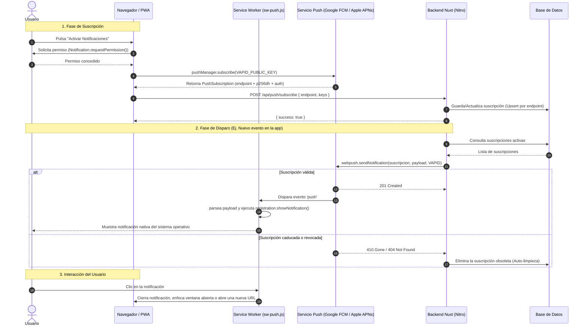

# Guía Definitiva: Implementación de Web Push Notifications en Nuxt PWA

Esta guía detalla paso a paso cómo implementar **Push Notifications nativas** en cualquier aplicación PWA construida con **Nuxt 3 o Nuxt 4**, utilizando el estándar de la W3C (Web Push API) junto con **VAPID**, **`@vite-pwa/nuxt`** y la librería backend **`web-push`**.

---

## 1. Arquitectura y Flujo de Comunicación

El estándar Web Push funciona como un triángulo entre el **Navegador del Usuario**, el **Servicio Push del Proveedor del Navegador** (Google FCM para Chrome/Android, Apple APNs para Safari/iOS, Mozilla Autopush para Firefox) y tu **Servidor Nuxt (Nitro)**.



---

## 2. Instalación de Dependencias

En la raíz de tu proyecto Nuxt, instala el módulo PWA y el paquete oficial de Web Push:

```bash
# Con pnpm
pnpm add @vite-pwa/nuxt web-push
pnpm add -D @types/web-push

# O con npm
npm install @vite-pwa/nuxt web-push
npm install -D @types/web-push
```

---

## 3. Generación de Llaves VAPID

VAPID (*Voluntary Application Server Identification*) permite que tu servidor Nuxt se autentique de forma segura ante Google, Apple y Mozilla sin necesidad de crear cuentas de desarrollador en cada plataforma.

Ejecuta en tu terminal:

```bash
npx web-push generate-vapid-keys
```

Obtendrás una salida similar a esta:

```text
=======================================
Public Key:
BBHQJKqHae_Ysp-iCAx7neo2UpfKtEIWZ9LY9cvdCeyCwMYJbpjJG47htGHmCxF2555Xm9ctTew_kIv08PBYrZg

Private Key:
JBT9l9rPr55jiqHFjB-muh0zQMOVxEo-h33pwIGYPjA
=======================================
```

> [!WARNING]
> Guarda la **Private Key** en estricto secreto. Si cambias estas llaves en el futuro, las suscripciones existentes quedarán invalidadas y los usuarios tendrán que volver a activar las notificaciones.

### Configurar `.env`

Añade las credenciales a tu archivo `.env`:

```env
# Llave pública compartida con el frontend
VAPID_PUBLIC_KEY=tu_public_key_aqui

# Llave privada que reside SOLO en el backend
VAPID_PRIVATE_KEY=tu_private_key_aqui

# Contacto requerido por los proveedores push (correo con prefijo mailto: o URL https)
VAPID_SUBJECT=mailto:admin@tu-dominio.com
```

---

## 4. Configurar `nuxt.config.ts`

En tu archivo de configuración de Nuxt, registra el módulo PWA, expón las llaves en `runtimeConfig`, y configura Workbox para que importe el script que gestiona las notificaciones push:

```typescript
// nuxt.config.ts
export default defineNuxtConfig({
  modules: [
    '@vite-pwa/nuxt'
  ],

  pwa: {
    manifest: {
      name: 'Mi Aplicación PWA',
      short_name: 'MiPWA',
      description: 'Mi PWA con notificaciones Web Push',
      theme_color: '#0f172a',
      background_color: '#020617',
      display: 'standalone',
      orientation: 'portrait',
      start_url: '/',
      icons: [
        {
          src: '/pwa-192x192.png',
          sizes: '192x192',
          type: 'image/png'
        },
        {
          src: '/pwa-512x512.png',
          sizes: '512x512',
          type: 'image/png'
        }
      ]
    },
    workbox: {
      // Importa el script del service worker que escuchará los eventos 'push'
      importScripts: ['sw-push.js'],
      navigateFallback: null,
      navigateFallbackDenylist: [/^\/api/]
    },
    client: {
      installPrompt: true
    },
    devOptions: {
      // Actívalo si necesitas depurar el Service Worker en entorno de desarrollo local
      enabled: false
    }
  },

  runtimeConfig: {
    // Variables privadas del servidor
    vapidPrivateKey: process.env.VAPID_PRIVATE_KEY || '',
    vapidSubject: process.env.VAPID_SUBJECT || '',
    public: {
      // Variable pública expuesta al navegador
      vapidPublicKey: process.env.VAPID_PUBLIC_KEY || ''
    }
  }
})
```

---

## 5. El Service Worker: `public/sw-push.js`

Crea el archivo `public/sw-push.js`. Este script corre en segundo plano en el navegador del usuario y se encarga de:
1. **Recibir el payload del push** y mostrar la notificación nativa mediante `self.registration.showNotification`.
2. **Gestionar el clic**: si la aplicación ya está abierta en una pestaña o ventana independiente, la enfoca y navega a la URL indicada; si está cerrada, abre una nueva ventana.

```javascript
// public/sw-push.js
// Manejadores Web Push cargados por Workbox vía importScripts

self.addEventListener('push', (event) => {
  let data = {}
  if (event.data) {
    try {
      data = event.data.json()
    } catch {
      data = { body: event.data.text() }
    }
  }

  const opciones = {
    body: data.body || '',
    icon: data.icon || '/pwa-192x192.png',
    badge: data.badge || '/pwa-192x192.png',
    tag: data.tag, // Si se envía un tag, notificaciones con el mismo tag se reemplazan
    data: {
      url: data.url || '/'
    }
  }

  event.waitUntil(
    self.registration.showNotification(data.title || 'Nueva Notificación', opciones)
  )
})

self.addEventListener('notificationclick', (event) => {
  event.notification.close()
  const destino = new URL(event.notification.data?.url || '/', self.location.origin).href

  event.waitUntil((async () => {
    const ventanas = await self.clients.matchAll({ type: 'window', includeUncontrolled: true })

    // Reutilizar la pestaña o ventana de la app si ya está abierta
    for (const ventana of ventanas) {
      if (new URL(ventana.url).origin === self.location.origin) {
        await ventana.focus()
        await ventana.navigate(destino).catch(() => {})
        return
      }
    }

    // Si la app está cerrada, abrir una ventana nueva
    await self.clients.openWindow(destino)
  })())
})
```

---

## 6. Modelo de Base de Datos para Suscripciones

Cada dispositivo o navegador registrado genera una suscripción única. Necesitas almacenar:
- `endpoint`: La URL del servidor push del navegador (única).
- `p256dh`: La llave pública ECDH del cliente.
- `auth`: El secreto de autenticación compartido.
- Opcionalmente: `user_agent`, `user_id` y fecha de creación.

### Ejemplo con Drizzle ORM (SQLite / PostgreSQL / MySQL):

```typescript
// server/db/schema.ts
import { sqliteTable, text, integer } from 'drizzle-orm/sqlite-core'

export const pushSubscriptions = sqliteTable('push_subscriptions', {
  id: integer('id').primaryKey({ autoIncrement: true }),
  endpoint: text('endpoint').notNull().unique(),
  p256dh: text('p256dh').notNull(),
  auth: text('auth').notNull(),
  user_agent: text('user_agent'),
  created_at: text('created_at').notNull()
})
```

---

## 7. Utilidades Compartidas (`shared/utils/push.ts`)

Crea un archivo utilitario que funcione tanto en cliente como en servidor:

```typescript
// shared/utils/push.ts

export interface PushPayload {
  title: string
  body: string
  url?: string
  tag?: string
  icon?: string
}

// Convierte la llave pública VAPID (base64url) al Uint8Array binario que espera pushManager.subscribe()
export function base64UrlAUint8Array(base64Url: string): Uint8Array<ArrayBuffer> {
  const padding = '='.repeat((4 - (base64Url.length % 4)) % 4)
  const base64 = (base64Url + padding).replace(/-/g, '+').replace(/_/g, '/')
  const raw = atob(base64)
  const output = new Uint8Array(raw.length)
  for (let i = 0; i < raw.length; i++) {
    output[i] = raw.charCodeAt(i)
  }
  return output
}

// Los servicios push de Google/Apple devuelven 404 o 410 cuando una suscripción expiró o el usuario revocó el permiso
export function suscripcionExpirada(statusCode?: number): boolean {
  return statusCode === 404 || statusCode === 410
}
```

---

## 8. Endpoints Nitro y Envío en el Backend

### 8.1. Utilidad de Envío y Limpieza Automática (`server/utils/webPush.ts`)

```typescript
// server/utils/webPush.ts
import webpush from 'web-push'
import { eq } from 'drizzle-orm'
import { db } from '../db'
import { pushSubscriptions } from '../db/schema'
import { suscripcionExpirada, type PushPayload } from '#shared/utils/push'

export interface ResultadoEnvioPush {
  total: number
  enviadas: number
  fallidas: number
  eliminadas: number
}

function obtenerVapid() {
  const config = useRuntimeConfig()
  const publicKey = config.public.vapidPublicKey
  const privateKey = config.vapidPrivateKey
  const subject = config.vapidSubject

  if (!publicKey || !privateKey || !subject) return null
  return { publicKey, privateKey, subject }
}

export function pushConfigurado(): boolean {
  return obtenerVapid() !== null
}

export async function enviarPush(
  payload: PushPayload,
  opciones: { endpoint?: string } = {}
): Promise<ResultadoEnvioPush> {
  const resultado: ResultadoEnvioPush = { total: 0, enviadas: 0, fallidas: 0, eliminadas: 0 }
  const vapidDetails = obtenerVapid()

  if (!vapidDetails) {
    console.warn('[web-push] Faltan llaves VAPID configuradas en el servidor')
    return resultado
  }

  const suscripciones = opciones.endpoint
    ? await db.select().from(pushSubscriptions).where(eq(pushSubscriptions.endpoint, opciones.endpoint))
    : await db.select().from(pushSubscriptions)

  resultado.total = suscripciones.length
  const cuerpo = JSON.stringify(payload)

  await Promise.all(suscripciones.map(async (s) => {
    try {
      await webpush.sendNotification(
        { endpoint: s.endpoint, keys: { p256dh: s.p256dh, auth: s.auth } },
        cuerpo,
        {
          vapidDetails,
          TTL: 60 * 60 * 24, // 24 horas de vigencia en el servidor push
          urgency: 'high',
          timeout: 5000 // 5 segundos máx para no bloquear funciones serverless
        }
      )
      resultado.enviadas++
    } catch (err: any) {
      const statusCode = err?.statusCode
      if (suscripcionExpirada(statusCode)) {
        // El dispositivo revocó permisos o desinstaló la PWA: eliminar suscripción obsoleta
        await db.delete(pushSubscriptions).where(eq(pushSubscriptions.id, s.id))
        resultado.eliminadas++
      } else {
        resultado.fallidas++
        console.error('[web-push] Error enviando notificación', { statusCode, endpoint: s.endpoint, err })
      }
    }
  }))

  return resultado
}
```

### 8.2. Endpoint para Suscribirse (`server/api/push/subscribe.post.ts`)

```typescript
// server/api/push/subscribe.post.ts
import { db } from '../../db'
import { pushSubscriptions } from '../../db/schema'

export default defineEventHandler(async (event) => {
  const body = await readBody(event)
  const endpoint = body?.endpoint
  const p256dh = body?.keys?.p256dh
  const auth = body?.keys?.auth

  if (!endpoint || !p256dh || !auth) {
    throw createError({ statusCode: 400, message: 'Faltan parámetros de suscripción (endpoint, p256dh, auth)' })
  }

  if (!URL.canParse(endpoint) || new URL(endpoint).protocol !== 'https:') {
    throw createError({ statusCode: 400, message: 'El endpoint debe ser una URL https válida' })
  }

  const userAgent = getHeader(event, 'user-agent') || null

  // Upsert: si el endpoint ya existe, actualiza sus llaves criptográficas
  await db.insert(pushSubscriptions).values({
    endpoint,
    p256dh,
    auth,
    user_agent: userAgent,
    created_at: new Date().toISOString()
  }).onConflictDoUpdate({
    target: pushSubscriptions.endpoint,
    set: { p256dh, auth, user_agent: userAgent }
  })

  return { success: true }
})
```

### 8.3. Endpoint para Desuscribirse (`server/api/push/unsubscribe.post.ts`)

```typescript
// server/api/push/unsubscribe.post.ts
import { eq } from 'drizzle-orm'
import { db } from '../../db'
import { pushSubscriptions } from '../../db/schema'

export default defineEventHandler(async (event) => {
  const body = await readBody<{ endpoint?: string }>(event)
  if (!body?.endpoint) {
    throw createError({ statusCode: 400, message: 'Falta el endpoint' })
  }

  await db.delete(pushSubscriptions).where(eq(pushSubscriptions.endpoint, body.endpoint))
  return { success: true }
})
```

### 8.4. Endpoint de Notificación de Prueba (`server/api/push/test.post.ts`)

```typescript
// server/api/push/test.post.ts
import { enviarPush, pushConfigurado } from '../../utils/webPush'

export default defineEventHandler(async (event) => {
  const body = await readBody<{ endpoint?: string }>(event)
  if (!body?.endpoint) {
    throw createError({ statusCode: 400, message: 'Falta el endpoint del dispositivo' })
  }

  if (!pushConfigurado()) {
    throw createError({ statusCode: 503, message: 'Web Push no está configurado en el servidor' })
  }

  const resultado = await enviarPush({
    title: '¡Notificaciones activas!',
    body: 'Este es un mensaje de prueba para confirmar que tu PWA recibe notificaciones en segundo plano.',
    url: '/'
  }, { endpoint: body.endpoint })

  return { success: true, ...resultado }
})
```

---

## 9. Composable de Vue 3: `app/composables/usePushNotifications.ts`

Este composable encapsula toda la interacción con la API nativa del navegador, la validación de rotación de llaves VAPID y la sincronización con tu backend:

```typescript
// app/composables/usePushNotifications.ts
import { base64UrlAUint8Array } from '#shared/utils/push'

const SW_READY_TIMEOUT_MS = 10000
const SUBSCRIBE_TIMEOUT_MS = 30000

function conLimiteDeTiempo<T>(promesa: Promise<T>, ms: number, mensaje: string): Promise<T> {
  let timer: ReturnType<typeof setTimeout> | undefined
  const limite = new Promise<never>((_, reject) => {
    timer = setTimeout(() => reject(new Error(mensaje)), ms)
  })
  return Promise.race([promesa, limite]).finally(() => clearTimeout(timer))
}

function mismaLlave(actual: ArrayBuffer | null, esperada: Uint8Array): boolean {
  if (!actual || actual.byteLength !== esperada.byteLength) return false
  const bytes = new Uint8Array(actual)
  return bytes.every((b, i) => b === esperada[i])
}

export const usePushNotifications = () => {
  const vapidPublicKey = useRuntimeConfig().public.vapidPublicKey

  const soportado = ref(false)
  const configurado = computed(() => Boolean(vapidPublicKey))
  const permiso = ref<NotificationPermission>('default')
  const suscrito = ref(false)
  const endpointActual = ref<string | null>(null)
  const cargando = ref(false)

  const obtenerRegistro = async (): Promise<ServiceWorkerRegistration> => {
    const actual = await navigator.serviceWorker.getRegistration()
    if (actual?.active) return actual

    return conLimiteDeTiempo(
      navigator.serviceWorker.ready,
      SW_READY_TIMEOUT_MS,
      'El service worker no está activo. Si estás en desarrollo, compila con pnpm build o activa devOptions en nuxt.config.'
    )
  }

  const actualizarEstado = async () => {
    soportado.value = 'serviceWorker' in navigator && 'PushManager' in window && 'Notification' in window
    if (!soportado.value) return

    permiso.value = Notification.permission
    const registro = await navigator.serviceWorker.getRegistration()
    const suscripcion = await registro?.pushManager.getSubscription()

    suscrito.value = Boolean(suscripcion) && permiso.value === 'granted'
    endpointActual.value = suscripcion?.endpoint ?? null
  }

  const activar = async () => {
    if (!configurado.value) {
      throw new Error('El servidor no tiene configurada la llave pública VAPID.')
    }

    cargando.value = true
    try {
      permiso.value = await Notification.requestPermission()
      if (permiso.value !== 'granted') {
        throw new Error('No se otorgó permiso para mostrar notificaciones.')
      }

      const registro = await obtenerRegistro()
      const llave = base64UrlAUint8Array(vapidPublicKey)
      let suscripcion = await registro.pushManager.getSubscription()

      // Si las llaves VAPID cambiaron en el servidor, renovar suscripción
      if (suscripcion && !mismaLlave(suscripcion.options.applicationServerKey, llave)) {
        await suscripcion.unsubscribe()
        suscripcion = null
      }

      suscripcion ??= await conLimiteDeTiempo(
        registro.pushManager.subscribe({
          userVisibleOnly: true,
          applicationServerKey: llave
        }),
        SUBSCRIBE_TIMEOUT_MS,
        'El navegador no respondió al registrarse en el servicio push.'
      )

      await $fetch('/api/push/subscribe', {
        method: 'POST',
        body: suscripcion.toJSON()
      })

      suscrito.value = true
      endpointActual.value = suscripcion.endpoint
    } finally {
      cargando.value = false
    }
  }

  const desactivar = async () => {
    cargando.value = true
    try {
      const registro = await navigator.serviceWorker.getRegistration()
      const suscripcion = await registro?.pushManager.getSubscription()

      if (suscripcion) {
        const endpoint = suscripcion.endpoint
        await suscripcion.unsubscribe()
        await $fetch('/api/push/unsubscribe', {
          method: 'POST',
          body: { endpoint }
        }).catch(() => {})
      }

      suscrito.value = false
      endpointActual.value = null
    } finally {
      cargando.value = false
    }
  }

  const enviarPrueba = async () => {
    if (!endpointActual.value) {
      throw new Error('Este dispositivo no tiene notificaciones activas.')
    }
    await $fetch('/api/push/test', {
      method: 'POST',
      body: { endpoint: endpointActual.value }
    })
  }

  return {
    soportado,
    configurado,
    permiso,
    suscrito,
    cargando,
    actualizarEstado,
    activar,
    desactivar,
    enviarPrueba
  }
}
```

---

## 10. Interfaz de Usuario de Ejemplo (Vue 3 / Nuxt UI)

```vue
<script setup lang="ts">
const {
  soportado,
  configurado,
  permiso,
  suscrito,
  cargando,
  actualizarEstado,
  activar,
  desactivar,
  enviarPrueba
} = usePushNotifications()

const probando = ref(false)

onMounted(async () => {
  await actualizarEstado()
})

const onActivar = async () => {
  try {
    await activar()
    alert('¡Notificaciones activadas con éxito!')
  } catch (err: any) {
    alert(err?.message || 'Error al activar')
  }
}

const onDesactivar = async () => {
  try {
    await desactivar()
  } catch (err: any) {
    alert(err?.message || 'Error al desactivar')
  }
}

const onProbar = async () => {
  probando.value = true
  try {
    await enviarPrueba()
    alert('Notificación de prueba enviada')
  } catch (err: any) {
    alert(err?.message || 'Error al enviar prueba')
  } finally {
    probando.value = false
  }
}
</script>

<template>
  <div class="p-6 max-w-md mx-auto bg-slate-900 text-white rounded-2xl shadow-lg space-y-4">
    <h2 class="text-xl font-bold flex items-center gap-2">
      🔔 Notificaciones Push
    </h2>

    <!-- Estado: No soportado -->
    <div v-if="!soportado" class="p-3 bg-red-950/50 border border-red-500/30 rounded-xl text-xs text-red-200">
      Tu navegador no soporta notificaciones Web Push. En iOS (iPhone/iPad), añade la app a la pantalla de inicio primero.
    </div>

    <!-- Estado: Falta VAPID -->
    <div v-else-if="!configurado" class="p-3 bg-amber-950/50 border border-amber-500/30 rounded-xl text-xs text-amber-200">
      Faltan las variables VAPID en el servidor.
    </div>

    <!-- Estado: Permiso Bloqueado -->
    <div v-else-if="permiso === 'denied'" class="p-3 bg-red-950/50 border border-red-500/30 rounded-xl text-xs text-red-200">
      Las notificaciones están bloqueadas en los ajustes de tu navegador o sistema operativo.
    </div>

    <!-- Acciones -->
    <div v-else class="flex items-center justify-between pt-2">
      <span class="text-sm font-medium" :class="suscrito ? 'text-emerald-400' : 'text-slate-400'">
        {{ suscrito ? '● Activas en este equipo' : '○ Inactivas' }}
      </span>

      <div class="flex gap-2">
        <template v-if="suscrito">
          <button
            class="px-3 py-1.5 bg-slate-800 hover:bg-slate-700 text-xs rounded-lg font-medium transition"
            :disabled="probando"
            @click="onProbar"
          >
            {{ probando ? 'Enviando...' : 'Probar' }}
          </button>
          <button
            class="px-3 py-1.5 bg-red-600 hover:bg-red-700 text-xs rounded-lg font-medium transition"
            :disabled="cargando"
            @click="onDesactivar"
          >
            Desactivar
          </button>
        </template>
        <button
          v-else
          class="px-4 py-2 bg-emerald-600 hover:bg-emerald-500 text-xs font-semibold rounded-lg shadow-md transition"
          :disabled="cargando"
          @click="onActivar"
        >
          {{ cargando ? 'Activando...' : 'Activar notificaciones' }}
        </button>
      </div>
    </div>
  </div>
</template>
```

---

## 11. Reglas de Oro y Casos Especiales para Producción

1. **Requisitos en iOS / iPadOS (Safari en iPhone)**:
   - A partir de **iOS 16.4**, Apple admite Web Push, pero con una **condición obligatoria**: el usuario debe agregar la PWA a la pantalla de inicio (*Compartir → Añadir a pantalla de inicio*) y abrirla desde el icono de la pantalla de inicio en modo *standalone*. En Safari como pestaña normal, la API de Notificaciones está deshabilitada por diseño de Apple.
2. **HTTPS Obligatorio**:
   - Salvo en `localhost`, los navegadores modernos rechazan tajantemente registrar Service Workers o solicitar permisos de notificación en orígenes no seguros (`http://`). Tu app debe contar con certificado SSL/TLS en producción.
3. **Persistencia y Timeouts en Serverless (Vercel, Netlify, Cloudflare Workers)**:
   - Los servicios push externos (FCM, Apple APNs) pueden experimentar latencias de red. Si respondes a la solicitud HTTP antes de que termine `webpush.sendNotification()`, el runtime serverless congelará el proceso y la notificación nunca saldrá. Siempre usa `await` o `waitUntil` con un timeout seguro (ej. 5000 ms).
4. **Auto-limpieza de Suscripciones**:
   - Cada vez que envíes una notificación, captura los códigos `404` y `410` (*Gone*). Indican que el usuario desinstaló la PWA o revocó el permiso desde el sistema. Elimina esa fila de la base de datos para no gastar recursos en envíos infructuosos.
5. **Pruebas Locales**:
   - Para probar en local, recuerda compilar la app con `pnpm build && pnpm preview` para que Vite genere el Service Worker de Workbox, o activa `devOptions: { enabled: true }` en `nuxt.config.ts`.
