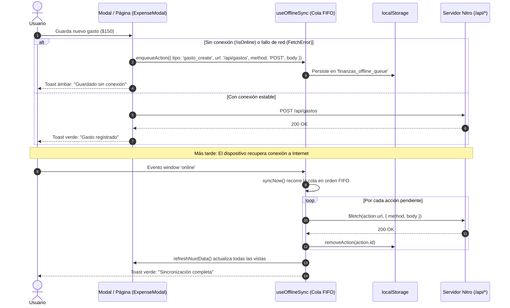

# Guía Completa: Arquitectura y Configuración de una PWA en Nuxt 4 (Offline-First)

Esta guía documenta paso a paso cómo está diseñada y configurada la **Progressive Web App (PWA)** en este proyecto (**Finanzas Personales** con **Nuxt 4** y **Nuxt UI v4**), abarcando desde el manifiesto y el Service Worker con Workbox hasta el motor propio de **caché Stale-While-Revalidate (SWR)**, la **cola de sincronización offline (FIFO)** y las **notificaciones Web Push**.

Al final del documento (Sección 9) se incluye una auditoría técnica con **oportunidades de mejora y código listo para implementar** para llevar la PWA al siguiente nivel.

---

## 1. Visión General de la Arquitectura PWA

A diferencia de una PWA básica que solo muestra una página de *"Sin conexión"*, este proyecto implementa una arquitectura **Offline-First Híbrida** dividida en cuatro capas:

1. **Capa de Instalación y Shell Nativo**: Manifiesto Web (`@vite-pwa/nuxt`), iconos adaptables (*maskable*), meta-etiquetas para iOS/Android y navegación inferior tipo app nativa (*Mobile Bottom Dock*).
2. **Capa de Red y Service Worker (Workbox)**: Pre-cacheo de activos estáticos (`js`, `css`, fuentes, iconos), estrategia `NetworkFirst` con timeout de 3 segundos para la API y ejecución de scripts en segundo plano (`sw-push.js`).
3. **Capa de Lectura Reactiva (`useCachedFetch`)**: Wrapper sobre `useFetch` que persiste respuestas en `localStorage` bajo el patrón *Stale-While-Revalidate* y precarga silenciosamente todas las rutas al iniciar la app (`prefetchAppRoutesData`).
4. **Capa de Escritura Resiliente (`useOfflineSync`)**: Cola persistente FIFO que intercepta creaciones, ediciones y eliminaciones cuando no hay red (o cuando cae súbitamente la petición) y las sincroniza automáticamente al recuperar la conexión.

```mermaid
flowchart TD
    subgraph Cliente["Navegador / Dispositivo Móvil (PWA)"]
        UI["Componentes y Páginas Vue"]
        CF["useCachedFetch (Lectura SWR)"]
        OS["useOfflineSync (Cola FIFO de Escritura)"]
        LS[("localStorage\n(Caché + Cola Offline)")]
        SW["Service Worker (Workbox + sw-push.js)"]
        CS[("Cache Storage\n(Assets + api-cache)")]
    end

    subgraph Servidor["Backend Nuxt (Nitro)"]
        API["Endpoints /api/*"]
        DB[("Base de Datos\n(SQLite / Turso)")]
    end

    UI -->|Lectura GET| CF
    CF -->|1. Entrega inmediata| LS
    CF -->|2. Revalidación en fondo| SW
    SW -->|NetworkFirst (Timeout 3s)| API
    SW <-->|Fallback si falla red| CS
    API <--> DB

    UI -->|Mutación POST/PUT/DELETE| OS
    OS -->|¿Hay internet?| API
    OS -->|Sin red o FetchError| LS
    LS -->|Evento 'online' -> syncNow()| API
```

---

## 2. Instalación y Dependencias

En [`package.json`](../package.json), la funcionalidad PWA se apoya en el módulo oficial `@vite-pwa/nuxt` (basado en `vite-plugin-pwa` y `workbox-build`) junto con `web-push` para notificaciones nativas:

```bash
# Módulo principal de PWA para Nuxt
pnpm add -D @vite-pwa/nuxt

# Opcional: Soporte para notificaciones Web Push (VAPID)
pnpm add web-push
pnpm add -D @types/web-push
```

---

## 3. Configuración Central en `nuxt.config.ts`

Toda la definición del manifiesto, las reglas de caché de Workbox y el comportamiento del cliente se concentran en [`nuxt.config.ts`](../nuxt.config.ts):

```typescript
// nuxt.config.ts
export default defineNuxtConfig({
  modules: [
    '@nuxt/eslint',
    '@nuxt/ui',
    '@vite-pwa/nuxt',
    'nuxt-auth-utils'
  ],

  pwa: {
    // 1. Web App Manifest (Instalabilidad y apariencia nativa)
    manifest: {
      name: 'Finanzas Personales',
      short_name: 'Finanzas',
      description: 'Estrategia de 2 tarjetas, nóminas y control de gastos inteligente',
      theme_color: '#0f172a',
      background_color: '#020617',
      display: 'standalone',
      orientation: 'portrait',
      start_url: '/',
      icons: [
        {
          src: '/pwa-192x192.png',
          sizes: '192x192',
          type: 'image/png'
        },
        {
          src: '/pwa-512x512.png',
          sizes: '512x512',
          type: 'image/png'
        },
        {
          src: '/pwa-512x512-maskable.png',
          sizes: '512x512',
          type: 'image/png',
          purpose: 'maskable any'
        }
      ]
    },

    // 2. Motor de Service Worker (Workbox)
    workbox: {
      // Carga manejadores personalizados (ej. notificaciones Web Push)
      importScripts: ['sw-push.js'],
      // Desactiva redirección por defecto en SSR para rutas no cacheadas
      navigateFallback: null,
      // Evita que el SW intercepte llamadas a la API o endpoints de sesión
      navigateFallbackDenylist: [/^\/api/, /^\/_auth/],
      // Pre-cachea todos los assets estáticos generados en el build de producción
      globPatterns: process.env.NODE_ENV === 'production'
        ? ['**/*.{js,css,html,png,svg,ico,woff2}']
        : undefined,
      // Caché dinámico en tiempo de ejecución para llamadas a la API
      runtimeCaching: [
        {
          urlPattern: ({ url }) => url.pathname.startsWith('/api/') && !url.pathname.includes('auth'),
          handler: 'NetworkFirst',
          method: 'GET',
          options: {
            cacheName: 'api-cache',
            expiration: {
              maxEntries: 100,
              maxAgeSeconds: 60 * 60 * 24 * 7 // 7 días
            },
            cacheableResponse: {
              statuses: [0, 200]
            },
            // Si la red demora más de 3 segundos (conexión móvil lenta), responde desde caché
            networkTimeoutSeconds: 3
          }
        }
      ]
    },

    // 3. Opciones en el navegador
    client: {
      installPrompt: true
    },

    // 4. Deshabilitado en dev para evitar conflictos de caché con el HMR de Vite
    devOptions: {
      enabled: false
    }
  }
})
```

### Decisiones Clave de esta Configuración
- **`handler: 'NetworkFirst'` con `networkTimeoutSeconds: 3`**: Ideal para datos financieros que cambian frecuentemente. Intenta obtener siempre el dato más fresco del servidor, pero si el usuario está en una zona con mala cobertura (3G/Edge) o sin datos, no bloquea la pantalla: a los 3 segundos entrega la última respuesta guardada en `api-cache`.
- **`!url.pathname.includes('auth')`**: Garantiza que las rutas de autenticación (`/api/auth/*` o `/api/_auth/*`) jamás queden cacheadas en el Service Worker.
- **`importScripts: ['sw-push.js']`**: Permite mantener la generación automática de Workbox (`generateSW`) sin tener que mantener manualmente todo el código de precacheo (`injectManifest`), delegando los eventos `push` y `notificationclick` al archivo [`public/sw-push.js`](../public/sw-push.js).

---

## 4. Activos Estáticos, Meta-Tags y Punto de Entrada (`app/app.vue`)

### 4.1. Estructura en `public/`
Los iconos deben ubicarse en la raíz de `public/` para servirse desde `/`:
- `public/favicon.ico` — Favicon clásico para navegadores de escritorio.
- `public/icon.svg` — Icono vectorial escalable.
- `public/apple-touch-icon.png` — Icono de 180x180 px requerido por iOS/iPadOS al añadir a la pantalla de inicio.
- `public/pwa-192x192.png` y `public/pwa-512x512.png` — Iconos estándar para Android, Windows y ChromeOS.
- `public/pwa-512x512-maskable.png` — Icono con área segura (*safe zone*) para que Android pueda recortarlo en círculo, ardilla (*squircle*) o lágrima sin cortar el logo.
- `public/sw-push.js` — Script importado por el Service Worker.

### 4.2. Integración en [`app/app.vue`](../app/app.vue)
En el componente raíz se inyectan los metadatos nativos, se monta `<VitePwaManifest />` y se inicializan los listeners y la precarga de datos:

```vue
<!-- app/app.vue -->
<script setup lang="ts">
useHead({
  title: 'Control por Tarjeta Activa | Finanzas Personales',
  meta: [
    { name: 'viewport', content: 'width=device-width, initial-scale=1, maximum-scale=1, user-scalable=no, viewport-fit=cover' },
    { name: 'description', content: 'Control inteligente de tarjetas de crédito y presupuesto por período de nómina.' },
    { name: 'theme-color', content: '#0f172a' },
    { name: 'mobile-web-app-capable', content: 'yes' },
    { name: 'mobile-web-app-status-bar-style', content: 'black-translucent' },
    { name: 'mobile-web-app-title', content: 'Finanzas' }
  ],
  link: [
    { rel: 'icon', type: 'image/svg+xml', href: '/icon.svg' },
    { rel: 'apple-touch-icon', href: '/apple-touch-icon.png' }
  ],
  htmlAttrs: { lang: 'es' }
})

const { initOfflineListeners, cacheConfigData, getCachedConfigData } = useOfflineSync()

// Carga la configuración global (tarjetas, día de nómina) con caché persistente
const { data: configData } = useCachedFetch('/api/configuracion', {
  key: 'global-config'
})

watch(configData, (val) => {
  if (val) cacheConfigData(val)
}, { immediate: true })

const effectiveConfig = computed(() => configData.value || getCachedConfigData())

onMounted(() => {
  // 1. Escucha eventos 'online' y 'offline' del navegador
  initOfflineListeners()
  // 2. Precarga en segundo plano todas las demás vistas para uso 100% offline
  prefetchAppRoutesData()
})
</script>

<template>
  <UApp>
    <NuxtLayout>
      <NuxtPage />
    </NuxtLayout>

    <!-- Modales Globales alimentados con effectiveConfig para funcionar sin red -->
    <ExpenseModal
      :tarjetas="effectiveConfig?.tarjetas"
      :dia-objetivo-nomina="effectiveConfig?.configuracion?.dia_objetivo_nomina"
    />
    <IncomeModal />
    <EditBudgetModal />

    <!-- Inyección automática del enlace <link rel="manifest" href="/manifest.webmanifest"> -->
    <VitePwaManifest />
  </UApp>
</template>
```

---

## 5. Estrategia de Lectura Offline: `useCachedFetch.ts`

El archivo [`app/composables/useCachedFetch.ts`](../app/composables/useCachedFetch.ts) implementa un patrón **Stale-While-Revalidate (SWR)** persistente en `localStorage`.

### ¿Cómo funciona?
1. Cuando una página solicita datos (ej. `useCachedFetch('/api/dashboard', { key: 'dashboard' })`), el composable busca primero en `localStorage` bajo la clave `finanzas_query_cache_dashboard`.
2. Si existe un valor previo, lo pasa como `default: () => initialCache` a `useFetch` con `lazy: true`. Así la interfaz se renderiza **instantáneamente** sin pantallas de carga vacías.
3. En paralelo, si hay internet, `useFetch` consulta al servidor y en el hook `onResponse` actualiza tanto el estado reactivo de Vue como el `localStorage`.
4. Si no hay conexión, `useFetch` falla silenciosamente pero mantiene intactos los datos de `initialCache` en pantalla.

### Precarga Proactiva (`prefetchAppRoutesData`)
Si el usuario abre la PWA en el Dashboard y luego pierde la conexión antes de entrar a `/historial` o `/reconciliacion`, esas vistas no tendrían datos en `localStorage`. Para resolverlo, `prefetchAppRoutesData()` descarga en segundo plano los endpoints principales apenas arranca la aplicación:

```typescript
// app/composables/useCachedFetch.ts
export async function prefetchAppRoutesData() {
  if (import.meta.server || !navigator.onLine) return
  const endpoints = [
    { url: '/api/configuracion', key: 'global-config' },
    { url: '/api/dashboard', key: 'dashboard' },
    { url: '/api/gastos', key: 'gastos' },
    { url: '/api/ingresos', key: 'ingresos' },
    { url: '/api/historial?meses=6', key: 'historial' },
    { url: '/api/reconciliaciones', key: 'reconciliaciones' }
  ]

  for (const item of endpoints) {
    try {
      const data = await $fetch(item.url)
      if (data) setLocalCachedData(item.key, data)
    } catch {
      // Ignorar errores silenciosamente en prefetch de fondo
    }
  }
}
```

---

## 6. Escritura Offline y Cola de Sincronización (`useOfflineSync.ts`)

Para que el usuario pueda seguir registrando gastos o ingresos en un avión, estacionamiento subterráneo o comercio sin señal, el proyecto incluye un sistema de encolado en [`app/composables/useOfflineSync.ts`](../app/composables/useOfflineSync.ts).



### Puntos Clave de Implementación
1. **Doble barrera de captura** (ej. en [`app/components/ExpenseModal.vue`](../app/components/ExpenseModal.vue)):
   - **Preventiva**: Si `!isOnline.value` es verdadero antes de enviar, encola inmediatamente sin intentar la llamada de red.
   - **Reactiva (`catch`)**: Si `navigator.onLine` decía `true` (falso positivo común en redes Wi-Fi sin salida a internet) y `$fetch` arroja un `FetchError`, el bloque `catch` captura el fallo y encola la acción sin perder los datos del formulario.
2. **Cálculos Financieros en Cliente (`shared/utils/cicloFinanciero.ts`)**:
   - Como la lógica de negocio para sugerir qué tarjeta usar hoy (`tarjetaSugeridaEn`) y cuándo se pagará un gasto (`calcularPeriodoPagoGasto`) vive en `shared/utils/`, el modal funciona al 100% sin consultar al servidor, apoyándose en el catálogo de tarjetas respaldado por `cacheConfigData()`.
3. **Feedback Visual (`app/components/OfflineSyncBanner.vue`)**:
   - Ubicado en [`app/layouts/default.vue`](../app/layouts/default.vue) dentro de `<ClientOnly>`, muestra automáticamente una barra contextual cuando el usuario está offline, cuando se están subiendo cambios o cuando quedaron registros pendientes con un botón **"Sincronizar ahora"**.

---

## 7. Higiene del Service Worker y Middleware de Autenticación

Dos detalles críticos evitan errores comunes al combinar Nuxt, autenticación y Service Workers:

### 7.1. Limpieza de Service Workers en Desarrollo ([`app/plugins/pwaCleanup.client.ts`](../app/plugins/pwaCleanup.client.ts))
Si alguna vez se activó un Service Worker en `localhost:3000`, el navegador seguirá interceptando peticiones en desarrollo y rompiendo el Hot Module Replacement (HMR) de Vite. Este plugin cliente:
- En **desarrollo (`import.meta.dev`)**: desregistra automáticamente cualquier Service Worker y vacía `window.caches`.
- En **producción**: verifica si quedó algún `dev-sw.js` residual o cachés antiguas (`pages-cache`) y las elimina limpiamente.

### 7.2. Exclusión de Rutas PWA en el Middleware Global ([`app/middleware/auth.global.ts`](../app/middleware/auth.global.ts))
Un middleware global de autenticación puede interceptar por error la descarga de `/manifest.webmanifest` o `/sw.js` y redirigirlos a `/login`, rompiendo la instalación de la PWA. Por ello, las primeras líneas del middleware excluyen estos recursos:

```typescript
// app/middleware/auth.global.ts
export default defineNuxtRouteMiddleware(async (to) => {
  if (
    to.path.includes('.') ||
    to.path.startsWith('/dev-sw') ||
    to.path.startsWith('/sw') ||
    to.path.startsWith('/manifest')
  ) {
    return
  }
  // ... resto de la verificación de sesión
})
```

---

## 8. Notificaciones Web Push

El proyecto integra notificaciones nativas en segundo plano mediante el estándar Web Push (VAPID) y el archivo [`public/sw-push.js`](../public/sw-push.js).
- Para consultar el detalle completo de llaves VAPID, base de datos de suscripciones, composable [`usePushNotifications.ts`](../app/composables/usePushNotifications.ts) y envío desde el backend con auto-limpieza de endpoints expirados (`404`/`410`), revisa la guía dedicada: **[`docs/GUIA_PUSH_NOTIFICATIONS_NUXT.md`](./GUIA_PUSH_NOTIFICATIONS_NUXT.md)**.

---

## 9. Oportunidades de Mejora y Recomendaciones para este Proyecto

Al auditar la configuración actual del repositorio, se identificaron **6 mejoras concretas** que pueden aplicarse para fortalecer la confiabilidad offline, la experiencia de usuario y el puntaje de auditoría en Lighthouse:

### Mejora 1: Separar `purpose: 'any'` y `purpose: 'maskable'` en el Manifest
- **Situación actual**: En [`nuxt.config.ts`](../nuxt.config.ts#L31-L36), el icono `/pwa-512x512-maskable.png` tiene `purpose: 'maskable any'`.
- **Por qué mejorar**: La especificación de la W3C y Lighthouse advierten contra el uso de `'maskable any'` juntos. Los iconos *maskable* tienen un margen interno amplio (zona segura del 80%) que hace que el icono se vea encogido si un sistema operativo lo utiliza como `any`.
- **Cómo implementarlo en `nuxt.config.ts`**:
  ```typescript
  manifest: {
    id: '/',
    name: 'Finanzas Personales',
    short_name: 'Finanzas',
    // ...
    icons: [
      {
        src: '/pwa-192x192.png',
        sizes: '192x192',
        type: 'image/png',
        purpose: 'any'
      },
      {
        src: '/pwa-512x512.png',
        sizes: '512x512',
        type: 'image/png',
        purpose: 'any'
      },
      {
        src: '/pwa-512x512-maskable.png',
        sizes: '512x512',
        type: 'image/png',
        purpose: 'maskable'
      }
    ]
  }
  ```

### Mejora 2: Soportar Arranque en Frío (Cold Start) sin Conexión cacheando Navegaciones SSR
- **Situación actual**: Al ser una aplicación SSR con `navigateFallback: null` en [`nuxt.config.ts`](../nuxt.config.ts#L42), las rutas de página (`/`, `/gastos`, `/ingresos`) son renderizadas por Nitro y no existen como archivos `.html` en el precache estático. Si el usuario cierra completamente la app en su teléfono y la vuelve a abrir cuando no tiene señal (Cold Start), el navegador solicita el documento HTML por red y falla antes de que Vue pueda montar y leer `localStorage`.
- **Cómo mejorarlo**: Añadir una regla en `pwa.workbox.runtimeCaching` para cachear las peticiones de documentos HTML (`request.mode === 'navigate'`) con estrategia `NetworkFirst`:
  ```typescript
  // En nuxt.config.ts -> pwa.workbox.runtimeCaching
  {
    urlPattern: ({ request, url }) =>
      request.mode === 'navigate' && !url.pathname.startsWith('/api/') && !url.pathname.startsWith('/login'),
    handler: 'NetworkFirst',
    options: {
      cacheName: 'pages-ssr-cache',
      networkTimeoutSeconds: 3,
      expiration: {
        maxEntries: 20,
        maxAgeSeconds: 60 * 60 * 24 * 7 // 7 días
      },
      cacheableResponse: {
        statuses: [0, 200]
      }
    }
  }
  ```

### Mejora 3: Evitar Redirección a `/login` al Abrir o Recargar la App en Modo Offline
- **Situación actual**: En [`app/middleware/auth.global.ts`](../app/middleware/auth.global.ts#L16-L22), si el usuario recarga la aplicación (`!ready.value`), se invoca `await fetchSession()`, que consulta `/api/_auth/session`. Si no hay internet en ese instante, la petición puede fallar, dejando `loggedIn.value === false` y redirigiendo al usuario a `/login` a pesar de tener una sesión válida y datos cacheados en el dispositivo.
- **Cómo mejorarlo**: Respaldar una bandera booleana en `localStorage` cuando la sesión está activa y consultarla en el middleware únicamente cuando el dispositivo esté offline (`!navigator.onLine`):
  ```typescript
  // app/middleware/auth.global.ts
  export default defineNuxtRouteMiddleware(async (to) => {
    if (
      to.path.includes('.') ||
      to.path.startsWith('/dev-sw') ||
      to.path.startsWith('/sw') ||
      to.path.startsWith('/manifest')
    ) {
      return
    }

    const { loggedIn, ready, fetch: fetchSession } = useUserSession()

    if (!ready.value) {
      try {
        await fetchSession()
      } catch {
        // Si falla por falta de red en el cliente, continuar evaluación abajo
      }
    }

    if (import.meta.client) {
      if (loggedIn.value) {
        localStorage.setItem('finanzas_auth_offline_ok', '1')
      } else if (!navigator.onLine && localStorage.getItem('finanzas_auth_offline_ok') === '1') {
        // Permitir navegación offline si tenía sesión activa antes de perder conexión
        if (to.path === '/login') return navigateTo('/')
        return
      }
    }

    if (!loggedIn.value && to.path !== '/login') {
      return navigateTo('/login')
    }

    if (loggedIn.value && to.path === '/login') {
      return navigateTo('/')
    }
  })
  ```
  *(Recordando limpiar `localStorage.removeItem('finanzas_auth_offline_ok')` dentro de `handleLogout` en [`app/layouts/default.vue`](../app/layouts/default.vue#L59)).*

### Mejora 4: Alinear la Clave de Caché de `/gastos` con `prefetchAppRoutesData`
- **Situación actual**: En [`app/composables/useCachedFetch.ts`](../app/composables/useCachedFetch.ts#L100), la función `prefetchAppRoutesData()` guarda la precarga de `/api/gastos` bajo la clave estática `'gastos'`. Sin embargo, en [`app/pages/gastos.vue`](../app/pages/gastos.vue#L45), la consulta usa una clave compuesta dinámica:
  `gastos-${filtroPeriodo.value}-${tarjetaId.value}-${categoriaFiltro.value}-${page.value}-${itemsPerPage.value}-${search.value}-${fechaInicio.value}-${fechaFin.value}`.
  Por ello, si el usuario abre la app y pasa a modo offline antes de haber visitado `/gastos`, la clave dinámica inicial no coincide con `'gastos'`.
- **Cómo mejorarlo**: En `prefetchAppRoutesData()`, precargar `/api/gastos?page=1&limit=10&periodo_nomina=actual` o permitir en `useCachedFetch` una opción `fallbackKey: 'gastos'` cuando la clave dinámica principal aún no tenga caché en `localStorage`.

### Mejora 5: Manejo de Errores `4xx` e Idempotencia en la Cola Offline (`useOfflineSync.ts`)
- **Situación actual**: En [`app/composables/useOfflineSync.ts`](../app/composables/useOfflineSync.ts#L105-L118), si una acción encolada devuelve un error `400 Bad Request` o `404 Not Found` (por ejemplo, intentar eliminar un gasto que ya fue eliminado desde otro dispositivo), el bloque `catch` incrementa `errorCount` pero conserva el elemento en `pendingQueue` para siempre, reintentándolo en cada reconexión.
- **Cómo mejorarlo**:
  1. Si el error HTTP es `404` en un `DELETE` o `400`/`422` de validación irrecuperable, descartar la acción de la cola y notificar al usuario.
  2. Agregar un campo `retries: number` a `OfflineAction` para descartar o pausar acciones que fallen más de 5 veces.
  3. **Actualización Optimista (Optimistic UI)**: Al encolar un `gasto_create` en modo offline, insertar temporalmente el gasto en el caché local (`finanzas_query_cache_dashboard` y `gastos`) con un flag `offlinePending: true` para que aparezca de inmediato en la lista antes de sincronizarse.

### Mejora 6: Botón de Instalación Nativo (`$pwa`), Auto-Actualización y Accesibilidad Mobile
- **Control de Actualizaciones e Instalación**:
  Añadir en `nuxt.config.ts` dentro de `pwa`:
  ```typescript
  pwa: {
    registerType: 'autoUpdate',
    workbox: {
      cleanupOutdatedCaches: true,
      clientsClaim: true,
      skipWaiting: true,
      // ...
    }
  }
  ```
  Además, se puede exponer en el menú móvil ([`app/layouts/default.vue`](../app/layouts/default.vue)) un botón **"Instalar App"** utilizando `const { $pwa } = useNuxtApp()` cuando `$pwa?.showInstallPrompt` sea `true` (`@click="$pwa.install()"`).
- **Accesibilidad y Safe Area en iOS**:
  - En [`app/app.vue`](../app/app.vue#L5), eliminar `maximum-scale=1, user-scalable=no` del meta `viewport` para permitir zoom de accesibilidad y subir el puntaje de Lighthouse a 100.
  - En [`app/layouts/default.vue`](../app/layouts/default.vue#L366), agregar `pb-[max(0.5rem,env(safe-area-inset-bottom))]` a la barra de navegación inferior (`<nav>`) para que no se solape con la barra gestual (*Home Indicator*) en iPhones modernos cuando la PWA corre en modo `standalone` con `viewport-fit=cover`.

---

## 10. Comandos para Probar y Auditar la PWA Localmente

Debido a que el Service Worker está desactivado en modo desarrollo (`pnpm dev`) para no interferir con Vite, siempre que quieras probar el modo offline, la instalación o las notificaciones push en tu máquina local, ejecuta el flujo de compilación y previsualización:

```bash
# 1. Compilar la aplicación y generar el Service Worker de Workbox (.output/public/sw.js)
pnpm build

# 2. Levantar el servidor de producción local en http://localhost:3000
pnpm preview
```

### Checklist de Verificación en Chrome DevTools (`F12` -> pestaña **Application**):
1. **Manifest**: Verifica que aparezcan el nombre, colores e iconos (`192x192`, `512x512` y `maskable`) sin advertencias.
2. **Service Workers**: Confirma que `sw.js` aparezca como *Activated and is running*.
3. **Cache Storage**: Revisa que existan `workbox-precache-v2` (con los bundles JS/CSS) y `api-cache` (con las respuestas de `/api/*`).
4. **Local Storage**: Verifica las claves `finanzas_query_cache_*`, `finanzas_cached_config` y, al desconectar la red desde la pestaña *Network -> Offline* y registrar un gasto, comprueba cómo se llena `finanzas_offline_queue` y se vacía automáticamente al volver a *No throttling*.

